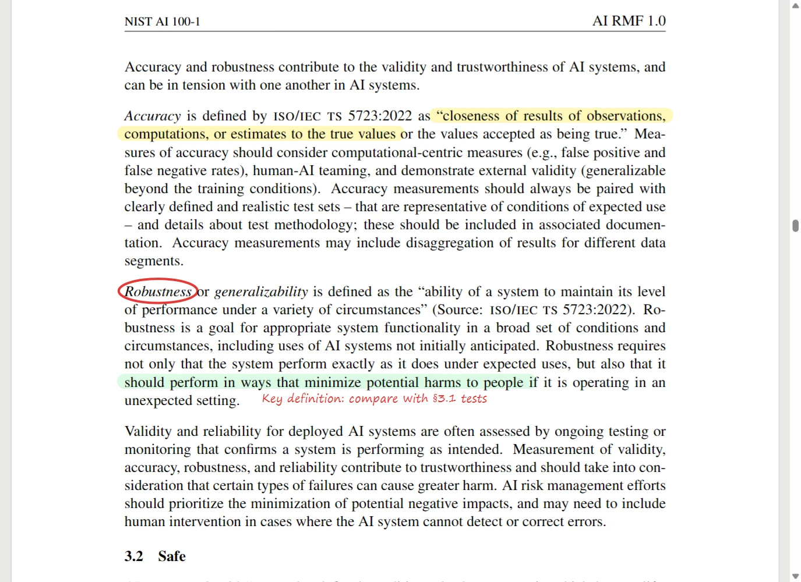
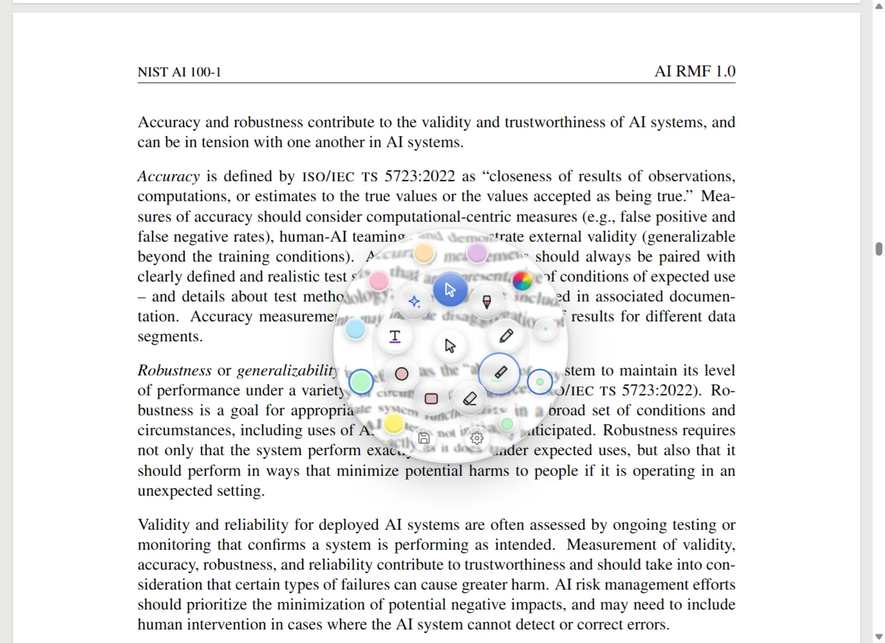
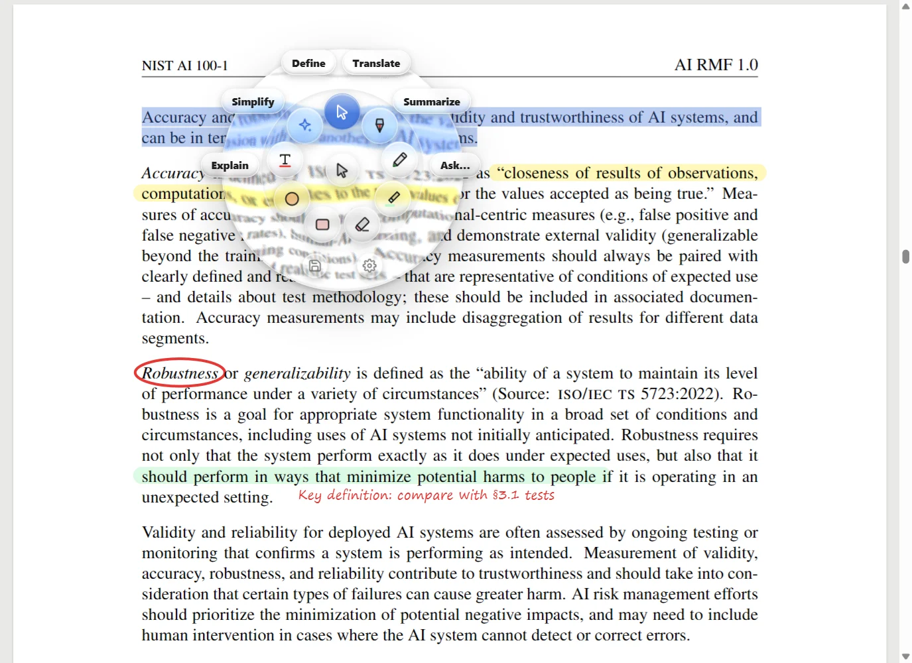
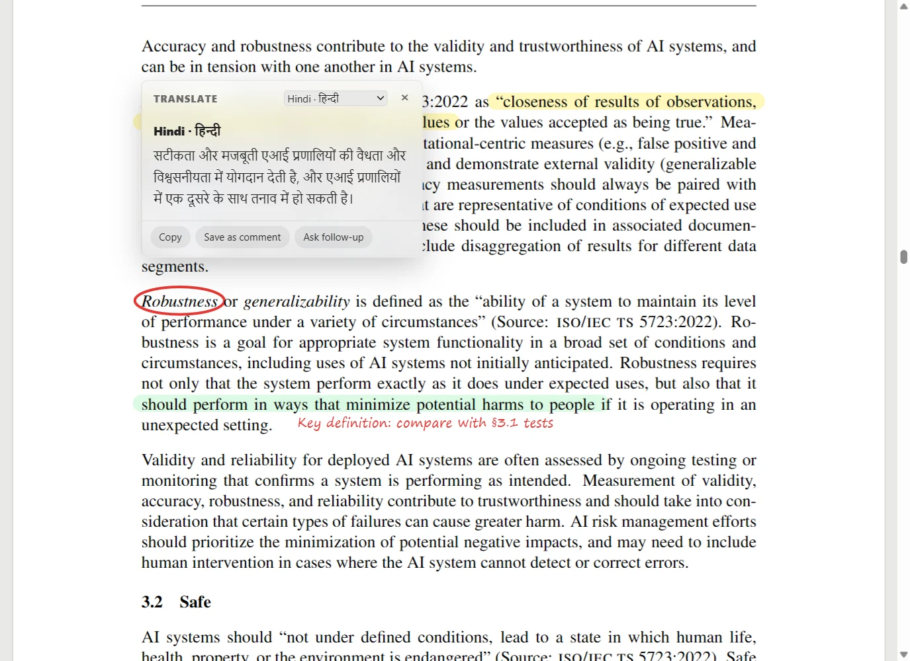
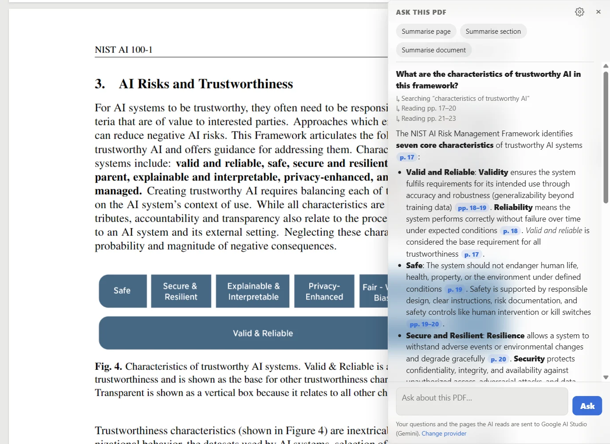
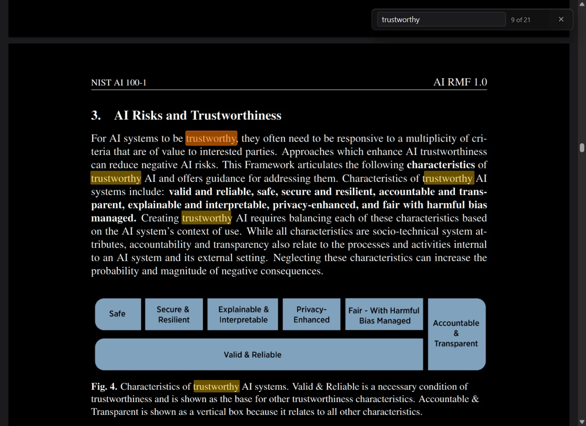
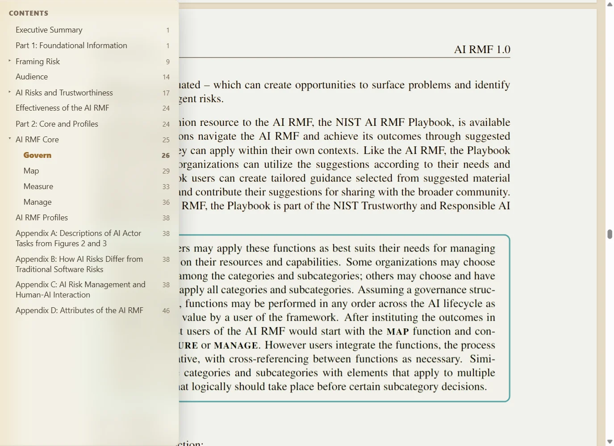
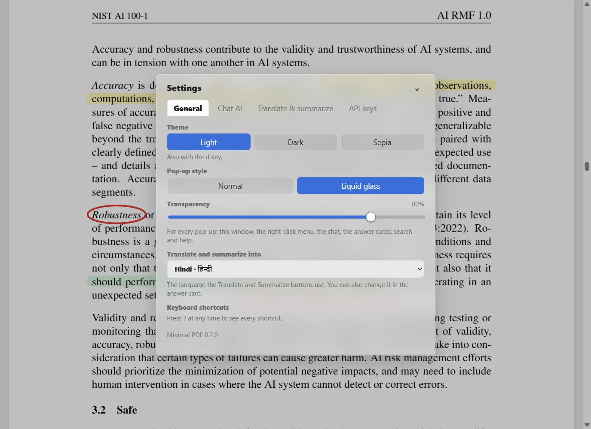
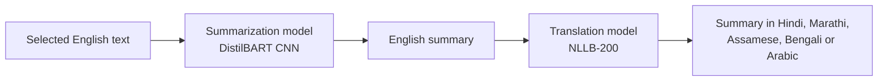
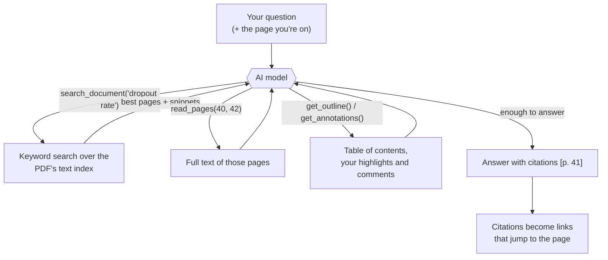

<h1 align="center">
  &nbsp;Minimal PDF
</h1>

<hr>

<p align="center">
  <a href="https://github.com/mishbahul-hub/minimal-pdf/releases/latest"></a>
  <a href="https://github.com/mishbahul-hub/minimal-pdf/releases"></a>
  
  
  
  
  <br>
  
  
  
  
</p>

<p align="center">
  <a href="#installation">Download</a> ·
  <a href="#screenshots">Screenshots</a> ·
  <a href="#ai-assistant">AI assistant</a> ·
  <a href="#keyboard-shortcuts">Shortcuts</a> ·
  <a href="#development">Development</a>
</p>

<p align="center"><i>A fast, keyboard-first PDF reader for Windows where the page is the whole interface.</i></p>

There is no toolbar: every control appears only when you ask for it and disappears with `Esc`.
Annotations live in a right-click radial menu, and an optional AI assistant can explain, translate,
summarize and answer questions about the document, citing the pages it used.

Built with [Tauri 2](https://tauri.app) and [PDF.js](https://mozilla.github.io/pdf.js/). The
installer is about 3 MB and the installed app about 8.5 MB, because it uses the WebView2 runtime
that ships with Windows.



## Contents

- [Highlights](#highlights)
- [Screenshots](#screenshots)
- [Installation](#installation)
- [Quick start](#quick-start)
- [Using Minimal PDF](#using-minimal-pdf)
  - [Reading and navigation](#reading-and-navigation)
  - [Annotations](#annotations)
  - [Saving](#saving)
  - [Settings](#settings)
- [AI assistant](#ai-assistant)
  - [Features](#features)
  - [Choosing a provider](#choosing-a-provider)
  - [Privacy](#privacy)
- [Offline translation and summaries](#offline-translation-and-summaries)
  - [Models](#models)
  - [Translation quality](#translation-quality)
- [How the RAG pipeline works](#how-the-rag-pipeline-works)
- [Keyboard shortcuts](#keyboard-shortcuts)
- [Where your data lives](#where-your-data-lives)
- [Troubleshooting](#troubleshooting)
- [Development](#development)
- [Roadmap](#roadmap)
- [Contributing](#contributing)
- [Changelog](#changelog)
- [Appendix: using Claude Code effectively](#appendix-using-claude-code-effectively)
- [Acknowledgements](#acknowledgements)
- [License](#license)

## Highlights

| | |
|---|---|
| **Fast** | Only the pages on screen are drawn, so a 500-page PDF scrolls as smoothly as a 5-page one. |
| **Keyboard first** | Read a whole document without touching the mouse; press `?` for every shortcut. |
| **Distraction-free** | No toolbar. Search, contents, help and tools open on demand and close with `Esc`. |
| **Annotations** | Pen, pencil, highlighter, eraser, rectangle, circle and text comments from a radial menu around the cursor. |
| **AI assistant (optional)** | Explain, simplify or define selected text; chat with the whole PDF with page citations; summaries. Works with free keys (Gemini, Groq, Hugging Face, OpenRouter), offline with Ollama, or with Claude. |
| **Offline translation** | English → Hindi, Marathi, Assamese, Bengali or Arabic, and summarize-then-translate, on your own computer with no key. |
| **Your files stay yours** | PDFs are never changed unless you explicitly choose **Replace original**. |

## Screenshots

| | |
|---|---|
|  |  |
| **Just the page.** No toolbar; everything opens on demand. | **Right-click menu.** Tools on the inner ring, colours and sizes on the outer ring. |
|  |  |
| **Selected text.** Explain, Simplify, Define, Translate, Summarize or Ask. | **Offline translation.** English → Hindi on this computer, no key. |
|  |  |
| **Chat with the PDF.** The AI searches and reads pages, and cites them. | **Search** (`/`) in the dark theme. |
|  |  |
| **Contents** (`t`) in the sepia theme. | **Settings** (`Ctrl+,`) with the liquid-glass style. |

<sub>The document in the screenshots is the NIST *AI Risk Management Framework* (NIST AI 100-1), a
public-domain US government publication.</sub>

## Installation

1. Download `Minimal.PDF_<version>_x64-setup.exe` from the
   [latest release](https://github.com/mishbahul-hub/minimal-pdf/releases/latest) and run it. An `.msi`
   installer is there too, for installing with company tools.
2. Windows may show a SmartScreen warning ("unknown publisher") because the installer is not
   code-signed yet. Choose **More info → Run anyway**.

| Requirement | |
|---|---|
| **Windows** | 10 or 11, 64-bit (x64) |
| **Disk** | about 10 MB for the app; about 1.2 GB more if you use offline Translate and Summarize |
| **Graphics card** | optional: offline models use it when available (WebGPU), otherwise the processor |
| **Internet** | only for AI chat, the one-time model download, and update checks |

Windows 10 and 11 already include WebView2, which the app uses to draw its window. After installing,
PDFs get an **Open with Minimal PDF** option, double-clicking a PDF opens it, and a second PDF opens
in the window that is already running.

**Updates.** A few seconds after it starts, the app checks for a new release and offers
**Install and restart**. Nothing is downloaded without your click.

To build the installers yourself, see [Development](#development).

**Uninstalling.** Use Windows **Settings → Apps → Installed apps → Minimal PDF → Uninstall**. Your
annotations and settings stay in `%APPDATA%\com.islam.minimalpdf\` in case you reinstall; delete that
folder to remove them too (see [Where your data lives](#where-your-data-lives)).

## Quick start

1. Press `Ctrl+O` and pick a PDF (or double-click one in File Explorer).
2. Scroll with the mouse, `Space` or `j` / `k`; jump pages with `n` / `p`.
3. Right-click the page for highlighters, pens and comments.
4. Select some text and right-click it to explain or translate it.
5. Press `c` to ask the AI about the whole document, and `?` to see every shortcut.

## Using Minimal PDF

### Reading and navigation

- **Open** a file with `Ctrl+O`. The start screen lists your recent files; press `1`–`9` to open one.
- **Remembers where you were.** Every PDF reopens on the same page and zoom.
- **Zoom that keeps your place:** `Ctrl` + mouse wheel, trackpad pinch, or `+` / `−`. Press `w` to
  switch between fit width and fit page.
- **Search** with `/`: case-insensitive, finds phrases across line breaks, and highlights every match.
- **Table of contents** with `t`: a slide-in sidebar built from the PDF's bookmarks.
- **Themes:** light, dark and sepia (`d`).

The full list is in [Keyboard shortcuts](#keyboard-shortcuts).

### Annotations

Right-click on a page (or press `a`) and a ring of tools appears around the cursor:

- **Inner ring:** pointer (back to reading and selecting text), pen, pencil, highlighter, eraser,
  rectangle, circle and text comment.
- **Outer ring:** colours and three sizes for the tool under your cursor, plus a rainbow button for
  **any colour you like**. The highlighter offers light, see-through colours (yellow, green, blue,
  pink, orange, lavender) so the text underneath stays readable.
- **Bottom of the ring:** the **save** button (floppy disk) and the **settings** gear.

Inside the open menu, `1`–`8` pick a tool, `9` opens the AI, and `Esc` closes it.

| Action | How |
|---|---|
| Draw or highlight | Drag on the page |
| Straight line, square, perfect circle | Hold `Shift` while dragging |
| Erase | Eraser tool: drag over a mark to remove it |
| Add a comment | Text tool: click where it should go, then type |
| Change a comment's font, size or colour | Use the small bar above the comment while typing |
| Edit an existing comment | Double-click it (with no tool active) |
| Finish a comment | `Esc`, `Ctrl+Enter`, or click elsewhere |
| Undo / redo | `Ctrl+Z` / `Ctrl+Y` |
| Put the tool down | `Esc` |

### Saving

Annotations are stored separately from the PDF (see [Where your data lives](#where-your-data-lives)).
To put them into a PDF, use the save button in the right-click menu:

| Option | Shortcut | What it does |
|---|---|---|
| **New PDF with annotations** | `Ctrl+S` | Saves a new PDF with your highlights, drawings and comments drawn in, so they show in any PDF reader. |
| **Plain copy** | `Ctrl+Shift+S` | Saves an exact copy of the PDF, without annotations. |
| **Replace original** | | Draws the annotations permanently into the original file, after asking you to confirm. |

### Settings

Settings opens with `Ctrl+,`, the gear at the bottom of the right-click menu, the gear in the chat
panel, or the **Settings** button on the start screen. It has four tabs:

| Tab | Contents |
|---|---|
| **General** | Theme (light, dark, sepia); **pop-up style** (**Normal**, or **Liquid glass** with a transparency slider) for every pop-up: settings, the right-click menu, chat, answer cards, search, contents and help; the language Translate and Summarize use; the app version. |
| **Chat AI** | The AI provider, its key and model. **Load models** lists the models the provider offers right now (names change often; the app suggests a default), and **Save and test** sends a one-word test request before saving. |
| **Translate & summarize** | The offline translation and summary models: whether they are downloaded, **Download now**, and **Remove**. |
| **API keys** | Every key saved on this computer, what it is used for, and a **Remove** button. |

## AI assistant

The AI features are optional. They work with **free API keys** from several providers, with a model
running on your own computer, or with Claude. The first time you use one, the app asks which
provider to use; change it any time in Settings → **Chat AI**.

### Features

- **Selected text.** Select some text, right-click it, and pick **Explain**, **Simplify** or
  **Define** (answered by your chat AI), or **Translate** or **Summarize** (answered by the
  [offline models](#offline-translation-and-summaries)). The answer appears in a small card next to
  the text, where you can copy it, **save it as a comment** on the page, or **ask a follow-up** in
  the chat.
- **Chat with the PDF** (`c`, or the ✦ button in the ring). Ask anything about the document. The AI
  searches and reads the PDF itself, showing each step (for example "Searching 'dropout'" or
  "Reading pp. 40–42"), and answers with page citations such as **p. 42** that jump to the page when
  clicked. It can also read your own highlights and comments.
- **Summaries.** Summarise the current page, the current section (from the table of contents) or the
  whole document. Summaries are saved with the file, so opening one again is instant and free.

### Choosing a provider

| Provider | Cost | Get a key |
|---|---|---|
| **Google AI Studio (Gemini)** | free tier | [aistudio.google.com](https://aistudio.google.com/app/apikey) → *Get API key* |
| **Groq** | free tier, very fast | [console.groq.com](https://console.groq.com/keys) → *API Keys* |
| **Hugging Face** | free monthly credits | [huggingface.co/settings/tokens](https://huggingface.co/settings/tokens): a token with *Make calls to Inference Providers* |
| **OpenRouter** | free models (ending in `:free`) | [openrouter.ai/keys](https://openrouter.ai/keys) |
| **Ollama** | free, offline, on your computer | no key: install [Ollama](https://ollama.com), then run `ollama pull llama3.2` |
| **Anthropic Claude** | paid | [console.anthropic.com](https://console.anthropic.com/settings/keys) |
| **Other** | any service with an OpenAI-compatible API | enter its address (base URL) and key |

Free tiers limit how much text you can send per minute, so with Groq, Hugging Face, OpenRouter and
Ollama the app sends fewer pages per request. If you see "too many requests", wait a minute.

### Privacy

- Nothing is sent until you ask.
- Your question, the selected text and the pages the AI reads go to the provider you chose. With
  Ollama, nothing leaves your computer.
- The PDF file itself is never uploaded.
- **Translate** and **Summarize** run on your computer: the text you select for them is never sent
  anywhere.
- Keys are kept in **Windows Credential Manager**, never in the app's files. The provider, model,
  address and model choices are kept in `settings.json`.

## Offline translation and summaries

**Translate** turns selected English text into **Hindi, Marathi, Assamese, Bengali or Arabic**.
**Summarize** is a two-step pipeline: it summarizes the English text, then translates the summary
into the language you pick (or leaves it in English). Choose the language in the answer card or in
Settings → General; the app remembers it. Arabic is shown right-to-left.

| Language | Script |
|---|---|
| Hindi · हिन्दी | Devanagari |
| Marathi · मराठी | Devanagari |
| Assamese · অসমীয়া | Bengali–Assamese |
| Bengali · বাংলা | Bengali–Assamese |
| Arabic · العربية | Arabic (right-to-left) |



Both models are open Hugging Face models that **run on your computer**, inside the app
([Transformers.js](https://huggingface.co/docs/transformers.js)):

- **No API key**, and the text you select never leaves your computer.
- Each model downloads **once**, the first time you use it (the card shows the progress), and then
  works **offline**. Settings → **Translate & summarize** shows whether they are downloaded, can
  download them ahead of time, and removes them to free space.
- They run in a background worker, so the page stays smooth while they work. They use your
  **graphics card** (WebGPU) when there is one, which is fast (2–3 seconds per sentence), and
  otherwise your **processor**.
- Each model is unloaded after a minute of no use, so it does not hold memory while you read.
- Long text is split at sentence ends: translation works a few sentences at a time, and summaries are
  built part by part.

### Models

| Task | Model | Download | Licence |
|---|---|---|---|
| Translation (all five languages) | [NLLB-200 distilled 600M](https://huggingface.co/Xenova/nllb-200-distilled-600M) (Meta) | about 1.3 GB (GPU) / 0.9 GB (CPU) | CC-BY-NC-4.0 (non-commercial) |
| English summaries | [DistilBART CNN 6-6](https://huggingface.co/Xenova/distilbart-cnn-6-6) | about 0.3 GB | Apache-2.0 |

### Translation quality

Measured on the standard [FLORES-101](https://huggingface.co/datasets/gsarti/flores_101) benchmark
(the first 100 *devtest* sentences of each language, English → target), using the app's own
Translate: the same model, settings and graphics-card engine you get.

| Language | BLEU | chrF |
|---|---:|---:|
| Hindi | 29.0 | 52.9 |
| Arabic | 18.8 | 50.3 |
| Bengali | 10.3 | 42.4 |
| Marathi | 9.3 | 40.0 |
| Assamese | 4.5 | 32.6 |

- **BLEU** (0–100) counts matching words and word sequences against a human translation. **chrF**
  (0–100) counts matching character sequences, which suits Indian languages better because one word
  can take many forms. Higher is better; human translations of the same text usually differ enough
  that even good translations score well below 100.
- **In practice:** Hindi and Arabic translations are usually good; Bengali and Marathi get the
  meaning across with some awkward wording; Assamese, which has much less training data, is the
  weakest and best treated as a rough guide.
- The app decodes greedily (one candidate at a time) to save memory, so a sentence occasionally ends
  with a repeated word.
- **Reproducing the scores:** run `node tools/eval/run-flores.mjs` while the app runs with remote
  debugging. The translations and scores are in [tools/eval/results](tools/eval/results). Scores are
  computed like [sacreBLEU](https://github.com/mjpost/sacrebleu)'s defaults (BLEU with 13a
  tokenization, chrF2).

## How the RAG pipeline works

RAG (*retrieval-augmented generation*) means the AI answers from passages **retrieved from your
document** instead of from memory. Minimal PDF uses **agentic RAG**: instead of the app guessing which
passages are relevant and pasting them in, the model gets *tools* to search and read the PDF and
decides for itself what to look up, as a person would with a book's index.



1. **Text extraction and index.** PDF.js extracts the text of each page (the same text layer you can
   select). For search, each page's text is normalised (lower case, runs of spaces and line breaks
   collapsed into one space) and kept with a map back to the exact characters, so a phrase split
   across lines still matches. Pages are indexed on demand and cached ([search.ts](src/search.ts)).
2. **Retrieval.** `search_document` scores every page: the whole phrase counts most (×10), then each
   keyword found on the page (×3), then the number of hits (×0.2, capped). Common words such as "the"
   or "which" are ignored. It returns the best pages with a snippet around the match.
3. **The agent loop.** The model has four tools and calls them as often as it needs, up to 12 rounds
   (24 for a whole-document summary). If a search finds nothing, it tries other words. Each call
   appears as a step in the chat ("Searching…", "Reading pp. 40–42"), so you can see where an answer
   came from.

   | Tool | Returns |
   |---|---|
   | `search_document(query)` | the best-matching pages, with snippets |
   | `read_pages(first, last)` | the full text of a few pages |
   | `get_outline()` | the table of contents with page numbers |
   | `get_annotations(first, last)` | your highlights (with the text under them), drawings and comments |

4. **A grounded answer.** The model is instructed to answer only from text it has read and to cite
   pages as `[p. 41]` or `[pp. 40–42]`. The app turns those into links that jump to the page and flash
   it. If the document does not cover the question, the model says so.
5. **Shortcuts and fallbacks.**
   - *Short documents* (a paper of a few pages) go into the prompt whole, so most questions need no
     tool calls. With Claude this part is cached, which makes follow-up questions cheaper.
   - *Models that cannot use tools* (some small or local models) get **simple RAG**: the app runs the
     keyword search itself and sends the best pages with the question. The chat says when this
     happens.
   - *Free tiers* get a smaller budget per request (fewer pages per read).

**Why no vector database or embeddings?** Classic RAG splits the document into chunks, turns each
into an embedding vector and looks up the nearest chunks. This app skips that on purpose:

- No setup, no extra model and no extra cost: the index is built locally and instantly from text
  PDF.js has already extracted.
- It works offline with Ollama.
- Answers quote exact text with exact page numbers, because whole pages are read rather than
  scattered chunks.
- The agent makes up for the main weakness of keyword search (different words for the same idea) by
  searching again with other terms.

**Limitations.** Scanned PDFs have no text layer, so there is nothing to search or read. Synonyms
depend on the model trying other words. Very long documents cannot be read in full in one answer, so
whole-document summaries rely on the table of contents and the main sections.

**Code:** the agent loop and tools are in [src/ai.ts](src/ai.ts), the provider adapters (Anthropic
Messages and OpenAI-compatible Chat Completions) in [src/llm.ts](src/llm.ts), and key handling and
streaming in [src-tauri/src/ai.rs](src-tauri/src/ai.rs).

## Keyboard shortcuts

| Key | Action |
|---|---|
| `Ctrl+O` | Open a file |
| `Ctrl+S` | Save a new PDF with your annotations drawn in |
| `Ctrl+Shift+S` | Save an exact copy of the PDF |
| `j` / `k`, `↓` / `↑` | Scroll a little |
| `Space` / `Shift+Space` | Next / previous screen |
| `n` / `p`, `→` / `←` | Next / previous page |
| `g g` / `G` | First / last page |
| `Ctrl+G` | Go to a page number |
| `+` / `−` / `0` | Zoom in / out / 100% |
| `w` | Fit width ↔ fit page |
| `f` or `F11` | Fullscreen |
| `d` | Light → dark → sepia |
| `/` or `Ctrl+F` | Search (`Enter` / `Shift+Enter`, or `n` / `N`, for next / previous match) |
| `t` | Table of contents |
| `a` or right-click | Annotation tools (and AI actions on selected text) |
| `c` | Ask AI about this PDF: chat and summaries |
| `Ctrl+,` | Settings: theme, chat provider, translation and summary models, API keys |
| `Ctrl+Z` / `Ctrl+Y` | Undo / redo annotations |
| `1`–`9` | Open a recent file (start screen) |
| `?` | Show all shortcuts |
| `Esc` | Close whatever is open / put the tool down / leave fullscreen |

Shortcuts are paused while you type in a box (search, go to page, chat, a comment), so letters
you type there never trigger them.

## Where your data lives

Everything the app saves is in `%APPDATA%\com.islam.minimalpdf\`:

| File | Contents |
|---|---|
| `settings.json` | Theme, pop-up style, recent files, the last position in each file, annotation tool styles, AI provider and model choices |
| `notes-<id>.json` | The annotations for one PDF (the file's path is stored inside it) and its saved AI summaries |

- AI provider keys, if you add any, are in Windows Credential Manager (`com.islam.minimalpdf`).
- The offline translation and summary models are cached by the app's WebView, under
  `%LOCALAPPDATA%\com.islam.minimalpdf\`. Remove them from Settings → **Translate & summarize**.
- Your PDF files are only ever read. The one exception is **Replace original**, which writes your
  annotations into the file after you confirm.

## Troubleshooting

| Problem | What to do |
|---|---|
| "Windows protected your PC" when installing | The installer isn't code-signed yet: choose **More info → Run anyway**. |
| "No searchable text in this PDF" | The PDF is scanned images with no text layer, so search and the AI have nothing to read. |
| "Too many requests" from the AI | Free tiers limit requests per minute: wait a minute and ask again. |
| "*Provider* is busy right now" | The provider's servers are overloaded: try again shortly, or pick another model in Settings → **Chat AI** (**Load models**). |
| The AI says a model isn't available | Model names change: open Settings → **Chat AI**, press **Load models** and choose a current one. |
| Translate or Summarize can't download the model | The first use needs an internet connection (about 1.2 GB in all); after that they work offline. |
| A password-protected PDF won't open | The app shows a clear message; open it in another reader to remove the password, then try again. |

## Development

**Prerequisites:** [Rust](https://rustup.rs), [Node.js](https://nodejs.org) LTS, and on Windows the
Microsoft C++ Build Tools ("Desktop development with C++").

```bash
npm install
npm run tauri dev      # run with hot reload
npm run tauri build    # build the installers (src-tauri/target/release/bundle/nsis and msi)
npx tsc --noEmit       # type-check
```

### Project structure

```
src/
  main.ts        start-up wiring (keys, settings, launch file)
  viewer.ts      loading, lazy page rendering, text layer, zoom, navigation
  keys.ts        the single keymap (the ? help is generated from it)
  overlays.ts    go-to-page box, help overlay, Esc handling
  settings.ts    theme, pop-up style, saved positions, recent files
  search.ts      text search and highlights
  outline.ts     table of contents sidebar
  annotate.ts    annotation tools, drawing, undo/redo, storage
  radial.ts      the right-click radial menu
  export.ts      saving: new PDF with annotations, plain copy, replace original
  update.ts      update check and install prompt
  ai.ts          AI features: selection actions, chat (agentic RAG over the PDF), summaries
  llm.ts         AI providers: Anthropic and OpenAI-compatible adapters, streaming
  hf.ts          offline translation and summarization (summarize, then translate)
  hfworker.ts    Web Worker that runs the offline models (Transformers.js)
  aisettings.ts  Settings dialog: General, Chat AI, Translate & summarize, API keys
  styles.css     all styles and themes
src-tauri/
  src/lib.rs     window sizing, launch file, single instance, recent-file access
  src/ai.rs      AI proxy: per-provider keys in the OS credential store, streaming
  tauri.conf.json, capabilities/default.json
tools/eval/      translation-quality evaluation (FLORES-101, BLEU and chrF) and its results
docs/screenshots/ the screenshots in this README
```

[CLAUDE.md](CLAUDE.md) holds the detailed design notes and conventions.

### Publishing a release

1. Bump the version in `src-tauri/tauri.conf.json`, `package.json` and `src-tauri/Cargo.toml`.
2. Commit, then tag and push: `git tag v0.2.0 && git push origin v0.2.0`.
3. The **Release** GitHub Action builds and signs the installers and creates a **draft** release.
   Check it, then press **Publish**. Installed apps will offer the update.

**One-time setup:** the repository needs a secret named `TAURI_SIGNING_PRIVATE_KEY` containing the
updater private key (`%USERPROFILE%\.tauri\minimal-pdf.key`). Keep that file safe: without it,
installed apps cannot verify future updates.

### Evaluating translation quality

`tools/eval/run-flores.mjs` translates FLORES-101 sentences with the running app and scores them with
`tools/eval/metrics.mjs` (BLEU and chrF). See [Translation quality](#translation-quality) for the
current results and how to rerun them.

## Roadmap

Ideas for future versions (not promises):

- A password prompt for protected PDFs
- `Ctrl+P` to switch quickly between recent files
- Two-page spread for books
- Vim-style marks to jump between saved places
- Reloading automatically when the PDF changes on disk
- An option to run Translate and Summarize with the chat AI instead of the offline models

## Contributing

Bug reports and ideas are welcome in [Issues](https://github.com/mishbahul-hub/minimal-pdf/issues).
Please include the app version (Settings → General), what you did, and what happened; a sample PDF
helps if the problem is specific to one file.

Pull requests: keep the design rules in [CLAUDE.md](CLAUDE.md) (no toolbar, keyboard first, no
frontend framework, ask before adding dependencies), run `npx tsc --noEmit`, and try the change in the
running app.

## Changelog

**0.2.1**
- Fixed chat with the newer Gemini models, which stopped after the first search ("missing a
  thought_signature").

**0.2.0**
- First public release: fast reading, search, contents, themes, annotations with the radial menu,
  saving with annotations, AI chat and selection actions with any provider, offline translation and
  summaries, and automatic updates.

---

## Appendix: using Claude Code effectively

This section is a practical guide to getting the most out of Claude Code while building this project.

### 1. Set up the project memory (`CLAUDE.md`)

Claude Code reads a `CLAUDE.md` file at the start of every session. It is the best place to record
project rules you would otherwise repeat in every chat.

- Run **`/init`** once there is some code, and Claude will generate a `CLAUDE.md` from the codebase.
- Add things like:
  - how to install, run, build and test the project;
  - coding style and conventions (naming, formatting, folder layout);
  - things to avoid ("don't add new dependencies without asking").
- Keep it short and up to date. Treat it like onboarding notes for a new teammate.

### 2. Start with a clear, specific request

Good prompts state the **goal**, the **context**, and **what "done" looks like**.

| Weak | Strong |
|------|--------|
| "Make a PDF reader" | "Create a Python desktop app using PyMuPDF and Tkinter that opens a PDF, shows one page at a time, and has Next/Previous buttons." |
| "Fix the bug" | "Opening a password-protected PDF crashes in `viewer.py`. Show a password prompt instead and add a test for it." |

Tips:
- Mention files with **`@`** (for example `@src/viewer.py`) so Claude reads exactly what you mean.
- Paste error messages and stack traces in full.
- Drag in screenshots when describing UI problems.

### 3. Plan before you build

For anything bigger than a small fix:

1. Switch to **Plan Mode** (press **Shift+Tab** to cycle modes in the CLI, or pick it from the mode
   menu in VS Code).
2. Ask Claude to explore the code and propose a plan.
3. Review and adjust the plan, then let it implement.

This catches misunderstandings before any files change.

### 4. Work in small, verifiable steps

- Build one feature at a time (for example "open a file", then "render a page", then "search").
- Ask Claude to **run the app or tests** after each change to confirm it works.
- Have Claude write tests early. They give it a way to check its own work.

### 5. Use version control

- Initialize git early: ask Claude to "initialize a git repo and add a `.gitignore` for this stack."
- Commit after each working step ("commit this with a descriptive message").
- If something goes wrong, you can always roll back. You can also press **Esc twice** in the CLI to
  rewind the conversation and code to an earlier point.

### 6. Stay in control

- Press **Esc** to interrupt Claude at any time and redirect it.
- Review the diffs Claude shows before accepting edits.
- Use **permission settings** (`/permissions`) to allow commands you trust (like running tests) so
  you are not prompted every time, while still approving risky actions.

### 7. Manage the conversation

- **`/clear`**: start fresh when switching to an unrelated task. Old context can confuse new work.
- **`/compact`**: summarize a long conversation to free up room while keeping the key points.
- **`/model`**: switch models (more powerful for hard problems, faster for simple ones).
- **`/help`**: list all available commands.

### 8. Automate repeated work

- **Custom slash commands / skills**: save prompts you use often (for example "review my changes")
  in `.claude/commands/` or `.claude/skills/` so you can run them with `/name`.
- **Hooks**: make things happen automatically, for example run a formatter after every edit. Ask
  Claude: "add a hook that runs the formatter after each file edit."
- **MCP servers**: connect Claude to external tools and data sources (databases, browsers, docs).

### 9. Ask Claude to explain

Claude Code is not only for writing code. Use it to learn:

- "Explain how this file works."
- "What are the trade-offs between PDF.js and PyMuPDF for this project?"
- "Review my code for bugs" (or use **`/code-review`**).

### Quick reference

| Action | How |
|--------|-----|
| Generate `CLAUDE.md` | `/init` |
| Plan before coding | Shift+Tab → Plan Mode |
| Reference a file | `@path/to/file` |
| Interrupt Claude | `Esc` |
| Rewind | `Esc` `Esc` |
| Fresh context | `/clear` |
| Shrink long chat | `/compact` |
| Change model | `/model` |
| Review code | `/code-review` |
| All commands | `/help` |

---

## Acknowledgements

Minimal PDF is built on [Tauri](https://tauri.app), [PDF.js](https://mozilla.github.io/pdf.js/),
[pdf-lib](https://pdf-lib.js.org) and [Transformers.js](https://huggingface.co/docs/transformers.js),
with Meta's [NLLB-200](https://huggingface.co/facebook/nllb-200-distilled-600M) and
[DistilBART](https://huggingface.co/sshleifer/distilbart-cnn-6-6) models (ONNX conversions by
[Xenova](https://huggingface.co/Xenova)). Translation quality is measured on
[FLORES-101](https://github.com/facebookresearch/flores), and badges come from
[shields.io](https://shields.io).

## License

*Add a license here (e.g. MIT).*
