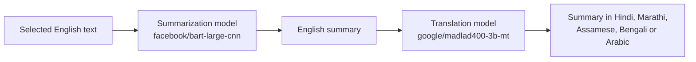
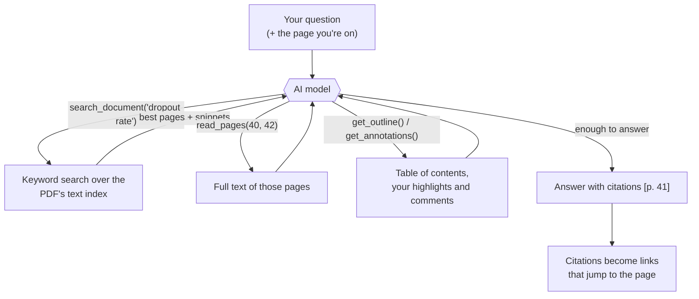

# Minimal PDF

A fast, keyboard-first PDF reader for Windows where **the page is the whole interface**. There's no
toolbar: everything appears only when you ask for it and disappears with `Esc`.

Built with [Tauri 2](https://tauri.app) and [PDF.js](https://mozilla.github.io/pdf.js/).
The installer is about 3 MB, and the installed app about 8.5 MB (it uses the WebView2 that ships with Windows).

## Features

- **Opens instantly, stays fast.** Only the pages on screen are drawn, so a 500-page PDF scrolls
  as smoothly as a 5-page one.
- **Keyboard first.** Read a whole document without touching the mouse (press `?` in the app for
  every shortcut).
- **Zoom that keeps your place.** Ctrl + mouse wheel, trackpad pinch, or `+` / `−`; fit width and
  fit page with `w`.
- **Search** (`/`): case-insensitive, finds phrases across line breaks, highlights every match.
- **Table of contents** (`t`): a slide-in sidebar from the PDF's bookmarks.
- **Light, dark and sepia themes** (`d`).
- **Remembers where you were.** Every PDF reopens on the same page and zoom; recent files are
  on the start screen (press `1`–`9`).
- **Annotations without a toolbar.** Right-click anywhere on a page for a radial menu around your
  cursor with pen, pencil, highlighter, eraser, rectangle, circle and text comments.
- **Ask AI about what you're reading** (optional, works with free keys from Google AI Studio,
  Groq, Hugging Face or OpenRouter, with Ollama offline, or with Claude): select text and right-click
  to explain, simplify, define or translate it; press `c` to chat with the whole PDF or summarise a
  page, section or the document, with answers that cite the pages they came from.
- **Never modifies your PDFs.** Annotations and settings are stored separately (see
  [Where your data lives](#where-your-data-lives)).
- Opens PDFs by double-click once installed, and reuses the open window.

## Annotations: the right-click menu

Right-click on a page (or press `a`) and a ring of tools appears around the cursor:

- **Inner ring:** pointer (back to reading and selecting text), pen, pencil, highlighter, eraser,
  rectangle, circle, text comment.
- **Outer ring:** colours and three sizes for the tool under your cursor, plus a rainbow button for
  **any colour you like**. The highlighter comes with light, see-through colours (yellow, green,
  blue, pink, orange, lavender) so the text underneath stays readable.

While a tool is active:

| Action | How |
|---|---|
| Draw / highlight | Drag on the page |
| Straight line, square, perfect circle | Hold `Shift` while dragging |
| Erase | Eraser tool: drag over a mark to remove it |
| Add a comment | Text tool: click where it should go, then type |
| Change a comment's font, size or colour | Use the small bar above the comment while typing |
| Edit an existing comment | Double-click it (with no tool active) |
| Finish a comment | `Esc`, `Ctrl+Enter`, or click elsewhere |
| Undo / redo | `Ctrl+Z` / `Ctrl+Y` |
| Put the tool down | `Esc` |

Inside the open menu, `1`–`8` pick a tool, `9` is the AI, and `Esc` closes it.

## AI: ask questions about the PDF

The AI features are optional. They work with **free API keys** from several providers, with a
model running on your own computer, or with Claude. The first time you use one, the app asks which
provider to use. Change it any time with `Ctrl+,`.

- **Selected text:** select some text, right-click it, and pick **Explain**, **Simplify** or
  **Define** (answered by your chat AI), or **Translate** or **Summarize** (Hugging Face models, see
  below) from the ring. The answer appears in a small card next to the text; you can copy it,
  **save it as a comment** on the page, or **ask a follow-up** in the chat.
- **Chat with the PDF** (`c`, or the ✦ button in the ring): ask anything about the document. The
  AI searches and reads the PDF itself (you see each step, like "Searching 'dropout'" or
  "Reading pp. 40–42") and answers with page citations such as **p. 42** that jump to the page
  when clicked. It can also read your own highlights and comments.
- **Summaries:** summarise this page, this section (from the table of contents) or the whole
  document. Summaries are saved with the file, so opening one again is instant and free.

### Choosing a provider

| Provider | Cost | Get a key |
|---|---|---|
| **Google AI Studio (Gemini)** | free tier | [aistudio.google.com](https://aistudio.google.com/app/apikey) → *Get API key* |
| **Groq** | free tier, very fast | [console.groq.com](https://console.groq.com/keys) → *API Keys* |
| **Hugging Face** | free monthly credits | [huggingface.co/settings/tokens](https://huggingface.co/settings/tokens): a token with *Make calls to Inference Providers* |
| **OpenRouter** | free models (ending in `:free`) | [openrouter.ai/keys](https://openrouter.ai/keys) |
| **Ollama** | free, offline, on your computer | no key: install [Ollama](https://ollama.com), then `ollama pull llama3.2` |
| **Anthropic Claude** | paid | [console.anthropic.com](https://console.anthropic.com/settings/keys) |
| **Other** | any service with an OpenAI-compatible API | enter its address (base URL) and key |

**Settings** opens with `Ctrl+,`, the ⚙ gear at the bottom of the right-click menu, the ⚙ in the
chat panel, or the **Settings** button on the start screen. It has four tabs:

- **General:** theme (light, dark, sepia), the language Translate and Summarize use, and the app
  version.
- **Chat AI:** pick the provider, paste the key, and press **Load models** to choose from the
  models that provider offers right now (model names change often; the app suggests a default).
  **Save and test** sends a one-word test request before saving.
- **Translate & summarize:** your Hugging Face token and the model for each task (see below).
- **API keys:** every key saved on this computer, what it's used for, and a **Remove** button.

Keys are kept in **Windows Credential Manager**, never in the app's files. The provider, model,
address and model choices go in `settings.json`.

Free tiers limit how much text you can send per minute, so with Groq, Hugging Face, OpenRouter and
Ollama the app sends fewer pages per request. If you see "too many requests", wait a minute.

**Privacy:** nothing is sent until you ask. Your question, the selected text and the pages the AI
reads go to the provider you chose; with Ollama nothing leaves your computer. The PDF file itself
is never uploaded.

### Translation and summaries (Hugging Face)

**Translate** turns selected English text into **Hindi, Marathi, Assamese, Bengali or Arabic**.
**Summarize** is a two-step pipeline: it summarizes the English text, then translates the summary
into the language you pick (or leaves it in English). Pick the language in the card; the app
remembers it. Arabic is shown right-to-left.



These run on Hugging Face's servers with **your Hugging Face token** (free monthly credits):
create one at [huggingface.co/settings/tokens](https://huggingface.co/settings/tokens) (a
*fine-grained* token with **Make calls to Inference Providers** ticked) and paste it in
`Ctrl+,` → **Translate & summarize**. It's the same token the Hugging Face chat provider uses.

| Task | Default model | Why |
|---|---|---|
| Translation (all five languages) | [google/madlad400-3b-mt](https://huggingface.co/google/madlad400-3b-mt) | translates into 400+ languages, including all five; Apache-2.0 |
| Hindi (alternative) | [Helsinki-NLP/opus-mt-en-hi](https://huggingface.co/Helsinki-NLP/opus-mt-en-hi) | small and fast, English → Hindi only |
| Arabic (alternative) | [Helsinki-NLP/opus-mt-tc-big-en-ar](https://huggingface.co/Helsinki-NLP/opus-mt-tc-big-en-ar) | English → Arabic only |
| English summaries | [facebook/bart-large-cnn](https://huggingface.co/facebook/bart-large-cnn) | Hugging Face's recommended summarizer |

You can pick a different model for each language, and for summaries. **Show all served models**
lists the models Hugging Face is running right now. Long text is split at sentence ends:
translation goes a few sentences at a time, and summaries are built part by part. If a model is
asleep, the first request can take a little longer while Hugging Face loads it.

## How the RAG pipeline works

RAG (*retrieval-augmented generation*) means the AI answers from passages **retrieved from your
document** instead of from memory. Minimal PDF uses **agentic RAG**: instead of the app guessing
which passages are relevant and pasting them in, the model gets *tools* to search and read the
PDF, and decides for itself what to look up, as a person would with a book's index.



**1. Text extraction and index.** PDF.js extracts the text of each page (the same text layer you
can select). For search, each page's text is normalised (lower case, runs of spaces and line breaks
collapsed into one space) and kept with a map back to the exact characters, so a phrase split
across lines still matches. Pages are indexed on demand and cached
([search.ts](src/search.ts)).

**2. Retrieval.** `search_document` scores every page: the whole phrase counts most (×10), then each
keyword found on the page (×3), then the number of hits (×0.2, capped). Common words like "the" or
"which" are ignored. It returns the best pages with a snippet around the match.

**3. The agent loop.** The model sees four tools:

| Tool | What it returns |
|---|---|
| `search_document(query)` | best-matching pages, with snippets |
| `read_pages(first, last)` | the full text of a few pages |
| `get_outline()` | the table of contents with page numbers |
| `get_annotations(first, last)` | your highlights (with the text under them), drawings and comments |

It calls them as often as it needs, up to 12 rounds (24 for a whole-document summary). If a search
finds nothing, it tries other words. Each call shows up as a step in the chat ("Searching…",
"Reading pp. 40–42"), so you can see where an answer came from.

**4. A grounded answer.** The instructions tell the model to answer only from text it has read and
to cite pages as `[p. 41]` or `[pp. 40–42]`. The app turns those into links that jump to the page
and flash it. If the document doesn't cover the question, the model says so.

**5. Shortcuts and fallbacks.**
- *Short documents* (a paper of a few pages) go into the prompt whole, so most questions need no
  tool calls at all. With Claude this part is cached, so follow-up questions are cheaper.
- *Models that can't use tools* (some small or local models) get **simple RAG**: the app runs the
  keyword search itself and sends the best pages along with the question. The chat says when this
  happens.
- *Free tiers* get a smaller budget per request (fewer pages per read).

**Why no vector database or embeddings?** Classic RAG splits the document into chunks, turns each
into an embedding vector and looks up the nearest chunks. This app skips that on purpose:

- No setup, no extra model and no extra cost: the index is built locally, instantly, from text
  PDF.js already extracted.
- It works offline with Ollama.
- Answers quote exact text with exact page numbers, because whole pages are read rather than
  scattered chunks.
- The agent makes up for the main weakness of keyword search, different words for the same idea,
  by searching again with other terms.

**Limitations.** Scanned PDFs have no text layer, so there is nothing to search or read. Synonyms
depend on the model trying other words. Very long documents can't be read in full in one answer,
so whole-document summaries rely on the table of contents and the main sections.

The code: the agent loop and tools are in [src/ai.ts](src/ai.ts), the provider adapters
(Anthropic Messages and OpenAI-compatible Chat Completions) in [src/llm.ts](src/llm.ts), and the
key handling and streaming in [src-tauri/src/ai.rs](src-tauri/src/ai.rs).

## Keyboard shortcuts

| Key | Action |
|---|---|
| `Ctrl+O` | Open a file |
| `j` / `k`, `↓` / `↑` | Scroll a little |
| `Space` / `Shift+Space` | Next / previous screen |
| `n` / `p`, `→` / `←` | Next / previous page |
| `g g` / `G` | First / last page |
| `Ctrl+G` | Go to a page number |
| `+` / `−` / `0` | Zoom in / out / 100% |
| `w` | Fit width ↔ fit page |
| `f` or `F11` | Fullscreen |
| `d` | Light → dark → sepia |
| `/` or `Ctrl+F` | Search (`Enter` / `Shift+Enter`, or `n` / `N`, for next / previous match) |
| `t` | Table of contents |
| `a` or right-click | Annotation tools (and AI actions on selected text) |
| `c` | Ask AI about this PDF: chat and summaries |
| `Ctrl+,` | Settings: theme, chat provider, translation and summary models, API keys |
| `Ctrl+Z` / `Ctrl+Y` | Undo / redo annotations |
| `1`–`9` | Open a recent file (start screen) |
| `?` | Show all shortcuts |
| `Esc` | Close whatever is open / put the tool down / leave fullscreen |

## Install

Download `Minimal PDF_<version>_x64-setup.exe` from the
[Releases](https://github.com/mishbahul-hub/minimal-pdf/releases) page and run it. Windows 10 and 11
already include WebView2, which the app uses to draw its window. After installing, PDFs get an
"Open with Minimal PDF" option.

**Updates:** the app checks for a new release a few seconds after it starts and offers
"Install and restart". Nothing is downloaded without your click.

Windows may show a SmartScreen warning ("unknown publisher") because the installer isn't code-signed
yet: choose **More info → Run anyway**.

To build the installers yourself, see [Development](#development); they end up in
`src-tauri/target/release/bundle/` (`nsis/` and `msi/`).

## Where your data lives

Everything the app saves is in `%APPDATA%\com.islam.minimalpdf\`:

- `settings.json`: theme, recent files, the last position in each file, annotation tool styles
- `notes-<id>.json`: the annotations for one PDF (the file's path is stored inside it), and saved AI summaries

AI provider keys, if you add any, are in Windows Credential Manager (`com.islam.minimalpdf`).

Your PDF files are only ever read, never written.

## Development

**Prerequisites:** [Rust](https://rustup.rs), [Node.js](https://nodejs.org) LTS, and on Windows the
Microsoft C++ Build Tools ("Desktop development with C++").

```bash
npm install
npm run tauri dev      # run with hot reload
npm run tauri build    # build the installers
npx tsc --noEmit       # type-check
```

### Publishing a release

1. Bump the version in `src-tauri/tauri.conf.json`, `package.json` and `src-tauri/Cargo.toml`.
2. Commit, then tag and push: `git tag v0.2.0 && git push origin v0.2.0`.
3. The **Release** GitHub Action builds and signs the installers and creates a **draft** release.
   Check it, then press **Publish**. Installed apps will offer the update.

One-time setup: the repository needs a secret named `TAURI_SIGNING_PRIVATE_KEY` containing the
updater private key (`%USERPROFILE%.tauriminimal-pdf.key`). Keep that file safe: without it,
installed apps can't verify future updates.

### Project structure

```
src/
  main.ts        start-up wiring (keys, settings, launch file)
  viewer.ts      loading, lazy page rendering, text layer, zoom, navigation
  keys.ts        the single keymap (the ? help is generated from it)
  overlays.ts    go-to-page box, help overlay, Esc handling
  settings.ts    theme, saved positions, recent files
  search.ts      text search and highlights
  outline.ts     table of contents sidebar
  annotate.ts    annotation tools, drawing, undo/redo, storage
  radial.ts      the right-click radial menu
  update.ts      update check and install prompt
  ai.ts          AI features: selection actions, chat (agentic RAG over the PDF), summaries, provider dialog
  llm.ts         AI providers: Anthropic and OpenAI-compatible adapters, streaming
  hf.ts          Hugging Face translation and summarization (summarize, then translate)
  aisettings.ts  AI settings dialog (Ctrl+,): chat provider, Hugging Face models, saved keys
  styles.css     all styles and themes
src-tauri/
  src/lib.rs     window sizing, launch file, single instance, recent-file access
  src/ai.rs      AI proxy: per-provider keys in the OS credential store, streaming
  tauri.conf.json, capabilities/default.json
```

`CLAUDE.md` holds the detailed design notes and conventions.

---

# Using Claude Code Effectively

This section is a practical guide to getting the most out of Claude Code while building this project.

## 1. Set up the project memory (`CLAUDE.md`)

Claude Code reads a `CLAUDE.md` file at the start of every session. It's the best place to record
project rules you'd otherwise repeat in every chat.

- Run **`/init`** once there is some code, and Claude will generate a `CLAUDE.md` from the codebase.
- Add things like:
  - How to install, run, build and test the project
  - Coding style and conventions (naming, formatting, folder layout)
  - Things to avoid ("don't add new dependencies without asking")
- Keep it short and up to date. Treat it like onboarding notes for a new teammate.

## 2. Start with a clear, specific request

Good prompts state the **goal**, the **context**, and **what "done" looks like**.

| Weak | Strong |
|------|--------|
| "Make a PDF reader" | "Create a Python desktop app using PyMuPDF and Tkinter that opens a PDF, shows one page at a time, and has Next/Previous buttons." |
| "Fix the bug" | "Opening a password-protected PDF crashes in `viewer.py`. Show a password prompt instead and add a test for it." |

Tips:
- Mention files with **`@`** (e.g. `@src/viewer.py`) so Claude reads exactly what you mean.
- Paste error messages and stack traces in full.
- Drag in screenshots when describing UI problems.

## 3. Plan before you build

For anything bigger than a small fix:

1. Switch to **Plan Mode** (press **Shift+Tab** to cycle modes in the CLI, or pick it from the mode menu in VS Code).
2. Ask Claude to explore the code and propose a plan.
3. Review and adjust the plan, then let it implement.

This catches misunderstandings before any files change.

## 4. Work in small, verifiable steps

- Build one feature at a time (e.g. "open a file", then "render a page", then "search").
- Ask Claude to **run the app or tests** after each change to confirm it works.
- Have Claude write tests early. They give it a way to check its own work.

## 5. Use version control

- Initialize git now: ask Claude to "initialize a git repo and add a `.gitignore` for this stack."
- Commit after each working step ("commit this with a descriptive message").
- If something goes wrong, you can always roll back. You can also press **Esc twice** in the CLI
  to rewind the conversation and code to an earlier point.

## 6. Stay in control

- Press **Esc** to interrupt Claude at any time and redirect it.
- Review the diffs Claude shows before accepting edits.
- Use **permission settings** (`/permissions`) to allow commands you trust (like running tests)
  so you're not prompted every time, while still approving risky actions.

## 7. Manage the conversation

- **`/clear`**: start fresh when switching to an unrelated task. Old context can confuse new work.
- **`/compact`**: summarize a long conversation to free up room while keeping the key points.
- **`/model`**: switch models (more powerful for hard problems, faster for simple ones).
- **`/help`**: list all available commands.

## 8. Automate repeated work

- **Custom slash commands / skills**: save prompts you use often (e.g. "review my changes")
  in `.claude/commands/` or `.claude/skills/` so you can run them with `/name`.
- **Hooks**: make things happen automatically, e.g. run a formatter after every edit.
  Ask Claude: "add a hook that runs the formatter after each file edit."
- **MCP servers**: connect Claude to external tools and data sources (databases, browsers, docs).

## 9. Ask Claude to explain

Claude Code isn't only for writing code. Use it to learn:

- "Explain how this file works."
- "What are the trade-offs between PDF.js and PyMuPDF for this project?"
- "Review my code for bugs" (or use **`/code-review`**).

## Quick Reference

| Action | How |
|--------|-----|
| Generate `CLAUDE.md` | `/init` |
| Plan before coding | Shift+Tab → Plan Mode |
| Reference a file | `@path/to/file` |
| Interrupt Claude | `Esc` |
| Rewind | `Esc` `Esc` |
| Fresh context | `/clear` |
| Shrink long chat | `/compact` |
| Change model | `/model` |
| Review code | `/code-review` |
| All commands | `/help` |

---

## License

*Add a license here (e.g. MIT).*
