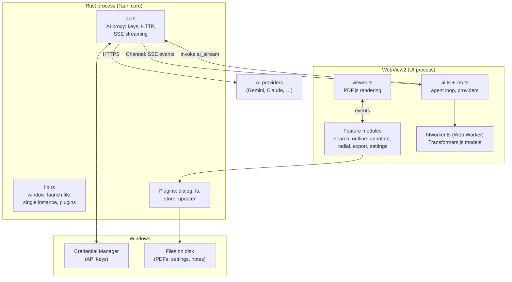

# 03 · Architecture

## The big picture

Tauri apps have two halves:

- **Rust core**: a native process that owns the window and has full OS access. It exposes
  *commands* that the UI can call (`invoke("ai_stream", …)`).
- **WebView**: the UI, which is HTML/CSS/TypeScript running in the system browser engine (WebView2 on
  Windows, which is Chromium-based). It is sandboxed: it can only reach the OS through commands and
  plugins that a permissions file allows.

## Why Tauri (and not Electron)?

| | Electron | Tauri |
|---|---|---|
| Browser engine | Bundles Chromium (~100+ MB) | Uses the OS WebView (already installed) |
| Backend | Node.js | Rust |
| Installer | ~80–150 MB | ~3 MB here |
| Memory | Higher (own Chromium) | Lower |
| Security model | Node in the main process | Explicit capability/permission system |

The project goal was "opens instantly, installer under ~10 MB", which Electron can't meet.
Trade-off: the app depends on the WebView version installed on the user's machine (WebView2 is
evergreen on Windows 10/11, so this is acceptable).

## Why no frontend framework?

The UI is mostly one scrollable list of pages plus a few on-demand overlays. A framework (React, Vue)
would add bundle size and a virtual-DOM layer between the code and the canvases it needs to manage
precisely (render cancellation, freeing memory). Plain DOM APIs give direct control. The cost is more
manual DOM code, kept manageable by splitting concerns into modules.

## Module map

| Module | Lines | Responsibility |
|---|---:|---|
| `main.ts` | 29 | Start-up wiring |
| `viewer.ts` | 694 | Load PDF, lazy page rendering, text layer, zoom, navigation; emits events |
| `keys.ts` | 148 | The single keymap and key dispatch (also generates the `?` help) |
| `overlays.ts` | 106 | Go-to-page box, help, overlay stack (`Esc` closes the top one) |
| `settings.ts` | 287 | Theme, UI style, per-file positions, recent files |
| `search.ts` | 390 | Text index per page, search, highlights; also `searchText` for the AI |
| `outline.ts` | 233 | Table of contents sidebar; also `getOutlineItems` for the AI |
| `annotate.ts` | 792 | Annotation tools, SVG layers, undo/redo, per-file storage |
| `radial.ts` | 387 | The right-click radial menu |
| `export.ts` | 226 | Write annotations into a PDF (pdf-lib) |
| `ai.ts` | 895 | Selection actions, chat panel, agent loop, tools, summaries |
| `llm.ts` | 411 | Provider presets, message-format translation, streaming parsers |
| `aisettings.ts` | 474 | Settings dialog (General, Chat AI, Translate & summarize, API keys) |
| `hf.ts` | 220 | Offline translate/summarise API, chunking, worker lifecycle |
| `hfworker.ts` | 88 | Web Worker running the Transformers.js pipelines |
| `update.ts` | 47 | Update check and install prompt |
| `lib.rs` | 120 | Window sizing, launch file, single instance, plugin registration |
| `ai.rs` | 392 | AI proxy: keys, endpoints, streaming, model list |

## Key design pattern: an event bus instead of tight coupling

`viewer.ts` knows nothing about search, annotations or settings. It emits events on an
`EventTarget`: `open`, `close`, `pagechange`, `scroll`, `pagerender`, `pagefree`, `openfailed`.
Feature modules subscribe:

- `pagerender` → search re-applies highlights to that page, annotations draw that page's SVG layer
- `pagefree` → they drop their per-page DOM
- `scroll` → settings saves the position (debounced 500 ms)
- `open` → annotations load the file's notes, the outline resets

**Why:** the viewer stays focused on rendering, features can be added or removed without touching
it, and there are no import cycles. This is the **observer pattern** using the browser's built-in
`EventTarget`.

## Data flow examples

**Opening a file**
1. `Ctrl+O` → `keys.ts` → `viewer.openPdf()` → native file dialog (dialog plugin).
2. The dialog adds that one file to the fs permission scope; `readFile` reads its bytes.
3. `openBytes(data, name)` → `pdfjs.getDocument({ data })`; one placeholder `
` per page, sized
   from each page's viewport, so the scrollbar is correct immediately.
4. `open` event → settings restores zoom and position; annotations load notes; title is set.
5. The `IntersectionObserver` reports visible placeholders → those pages render.

**Asking the AI a question**
1. `ai.ts` builds the conversation in Anthropic block format and calls `llm.callModel`.
2. `llm.ts` translates it for the chosen provider and calls `invoke("ai_stream", { body, onEvent })`.
3. `ai.rs` reads the key from Credential Manager, sends the HTTPS request, parses the
   server-sent-event stream, and forwards each event's JSON over a Tauri **Channel**.
4. `llm.ts` assembles text and tool calls from the stream; `ai.ts` runs the tools locally
   (search, read pages) and loops until the model answers.

## Where data is stored

| Data | Where | Format |
|---|---|---|
| Settings, recent files, positions | `%APPDATA%\com.islam.minimalpdf\settings.json` | JSON (store plugin) |
| Annotations + AI summaries for one PDF | `notes-<hash of path>.json` in the same folder | JSON |
| API keys | Windows Credential Manager (service `com.islam.minimalpdf`) | OS-encrypted |
| Offline models | WebView Cache Storage (`transformers-cache`) | ONNX files |
| The PDF itself | Untouched (unless "Replace original") | |

The notes file name uses an **FNV-1a hash** of the file path: short, stable, filesystem-safe.

## Design principles (and why)

1. **The page is the UI.** No toolbar. Overlays register on a stack; `Esc` closes the top one.
2. **Keyboard first.** One keymap table is the single source of truth for shortcuts *and* the help
   screen, so they can't drift apart.
3. **Render only what's visible.** Memory and speed scale with the screen, not the document.
4. **Never modify the user's PDF without explicit confirmation.**
5. **Minimal dependencies.** Each new package needs a reason (installer size, attack surface).
